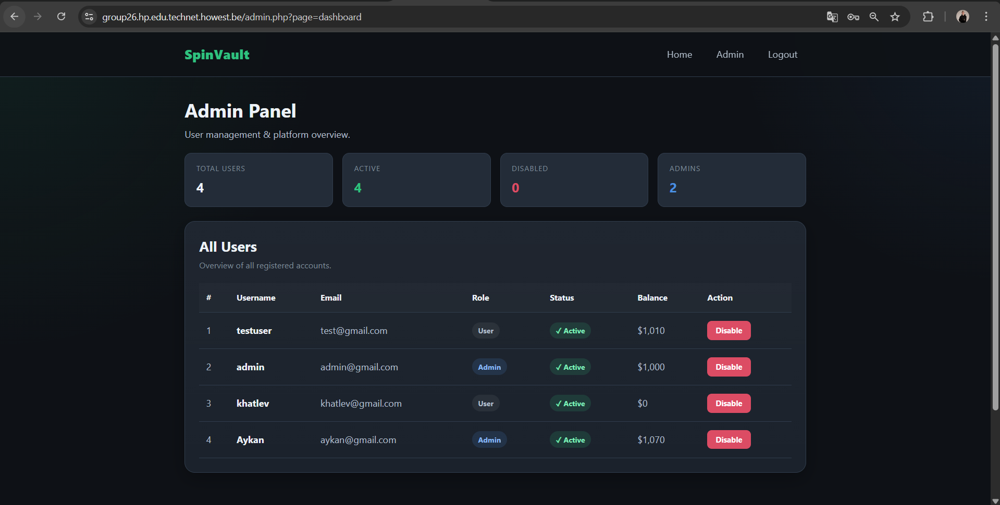
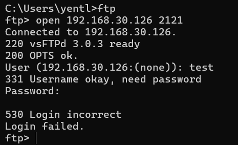
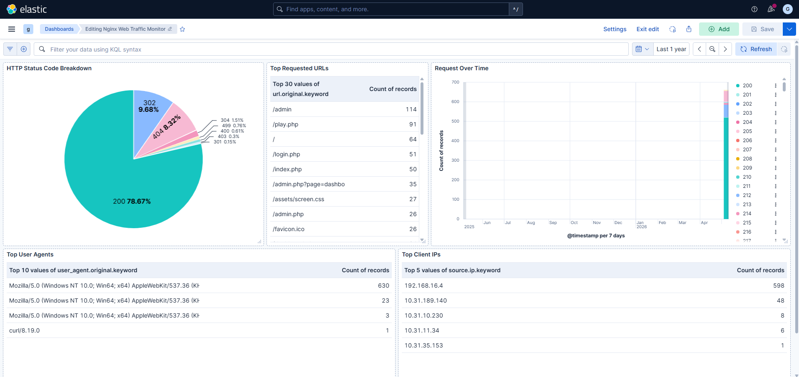

# Group 26 README

Link of our website: https://group26.hp.edu.technet.howest.be/

Made by: RIDVANOV Aykan, HU Dennis, JANSSENS Levani, SINNAEVE Yentl

## Installation & Setup

TODO Steps to setup the site:

## Honeypots

### 1. Fake admin page

A fake admin login page is available at `/admin`. This is to tric people into thinking they have found the admin login page. In reality, there is not admin page. Admin acces can only be given inside of the database. (the /admin page is also visible inside the robots.txt)

#### How it works

- When an attacker tries to login with admin / admin, they are presented with a fake admin dashboard. Here they can disable sertain users. Everything you do on here is fake.

- Every login attemp and action performed on the fake page, is being logged.

#### What gets logged

- Attackers IP
- Time
- Requested URL

### 2. Fake ftp server

A fake ftp server is available at `port 2121`. This is to see if an attacker is using a port scan.

#### How it works

- The server accepts incoming connections on port 2121.

- Nobody can login. There are no valid users.

- All connection and login attempts are being logged.

---

Example of how to use it:

#### What gets logged

- Attackers IP
- Time
- Captured credentials

## Secure Environment

### Main application

The web application is a casino-themed slot machine game. Users can register and log in to access the platform.

Once logged in, users have access to the following features:
- **Dashboard** — overview of your balance, total spins and role
- **Play** — spin the slot machine and place bets
- **Profile** — update your username, email and bio
- **Avatar** — upload a profile picture
- **History** — view your past spins

Admins have access to an admin panel where they can manage and enable/disable users.

###  Security Measures

The application files are located at `/usr/share/nginx/group26/public/` and the Nginx configuration file at `/etc/nginx/conf.d/group26.conf`.

- **HTTPS** — SSL enabled on port 443 with certificates generated by **CertBot**. HTTP traffic on port 80 is automatically redirected to HTTPS.
- **XSS** — 
- **IDOR** — 
- **SQLi** — 
- **CSRF** — 
- **SSRF** — 
- **Code Injection** — 
- **CSP Headers** — 

## Logging

For the logging we use Kibana as the visual interface. The data itself is being collected by Elasticsearch.

To acces the logging page, go to https://elastic.hp.edu.technet.howest.be:5601. Login with `group-26 / group26ADYL`

Go to the `dashboards` tab. There you will see 3 dashboards.

### 1. Nginx web traffic monitor.

Shows traffic of the main application. 

### 2. Honeypot monitor

Shows traffic of the first honeypot (fake /admin page)

### 3. FTP-Honeypot monitor

Shows traffic of the fake FTP server.

