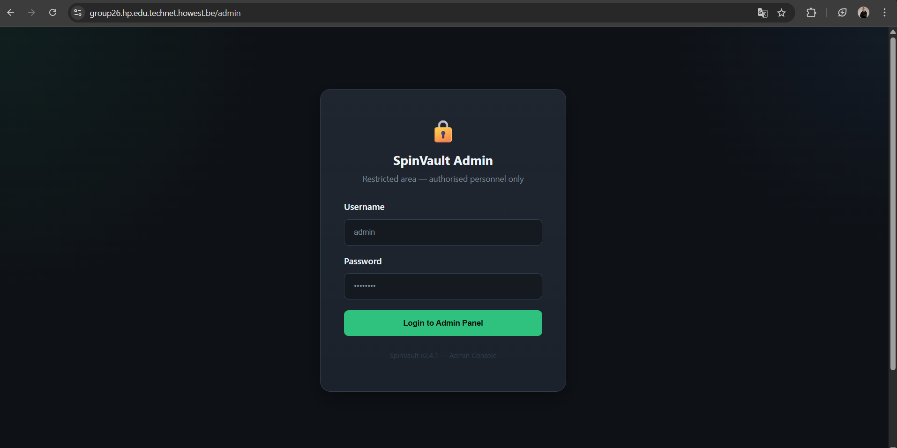
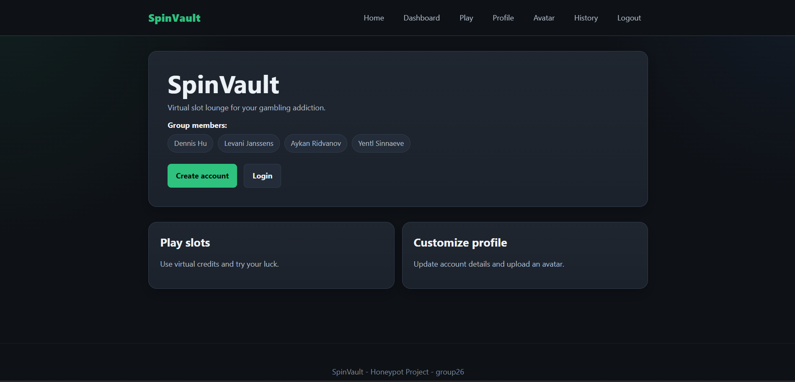
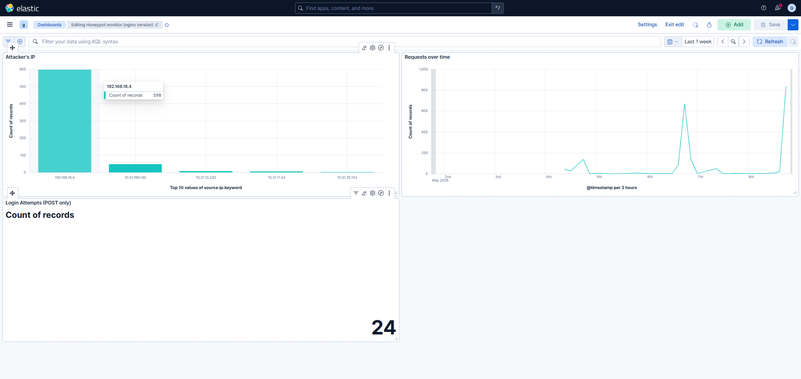
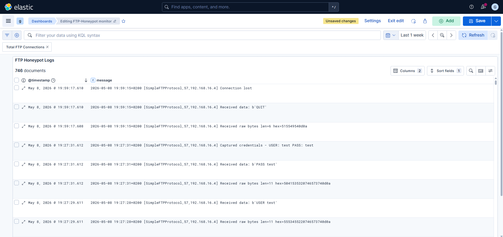
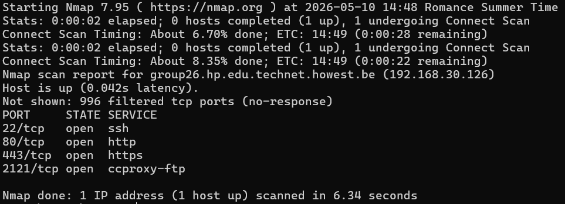

# Group 26 README

Link of our website: https://group26.hp.edu.technet.howest.be/

Made by: RIDVANOV Aykan, HU Dennis, JANSSENS Levani, SINNAEVE Yentl

## Installation & Setup

### Prerequisites

- A Linux server (Ubuntu recommended)
- Nginx
- PHP 8.4 + php8.4-fpm
- MySQL
- Python 3 + pip
- Filebeat
- Certbot (for SSL)

### 1. Clone the repositories

```bash
git clone <honeypot_group26_code repo URL>
git clone <honeypot_group26_config repo URL>
```

### 2. Set up the database

```bash
mysql -u root -p < honeypot_group26_code/group26/schema.sql
```

This creates the `slot_honeypot` database with two tables: `users` and `spins`.

Then create the MySQL user used by the application:

```sql
CREATE USER 'slotuser'@'localhost' IDENTIFIED BY 'StrongPassword123!';
GRANT ALL PRIVILEGES ON slot_honeypot.* TO 'slotuser'@'localhost';
FLUSH PRIVILEGES;
```

### 3. Deploy the web application

Copy the application files to the Nginx web root:

```bash
sudo mkdir -p /usr/share/nginx/group26
sudo cp -r honeypot_group26_code/group26/* /usr/share/nginx/group26/
```

Copy the fake admin honeypot:

```bash
sudo mkdir -p /usr/share/nginx/honeypot
sudo cp honeypot_group26_code/honeypot/admin.php /usr/share/nginx/honeypot/
```

Create the honeypot log directory:

```bash
sudo mkdir -p /var/log/honeypot
sudo chown www-data:www-data /var/log/honeypot
```

### 4. Configure Nginx

Copy the Nginx configuration files:

```bash
sudo cp honeypot_group26_config/nginx/nginx.conf /etc/nginx/nginx.conf
sudo cp honeypot_group26_config/nginx/conf.d/group26.conf /etc/nginx/conf.d/group26.conf
```

### 5. Obtain an SSL certificate with Certbot

```bash
sudo apt install certbot python3-certbot-nginx
sudo certbot --nginx -d group26.hp.edu.technet.howest.be
```

Certbot will automatically update the Nginx config with the certificate paths.

### 6. Restart Nginx and PHP-FPM

```bash
sudo systemctl restart php8.4-fpm
sudo systemctl restart nginx
```

### 7. Set up the FTP honeypot

Install the required Python dependencies:

```bash
cd honeypot_group26_code/ftp-honeypot
pip install twisted
```

Run the FTP honeypot (default port 2121):

```bash
python3 ftp.py
```

Optional arguments:

```bash
python3 ftp.py --host 0.0.0.0 --port 2121 --banner "220 Welcome to the FTP Honeypot"
```

To keep it running in the background:

```bash
nohup python3 ftp.py &
```

### 8. Configure Filebeat

Copy the Filebeat configuration files:

```bash
sudo cp honeypot_group26_config/filebeat/filebeat.yml /etc/filebeat/filebeat.yml
sudo cp honeypot_group26_config/filebeat/modules.d/nginx.yml /etc/filebeat/modules.d/nginx.yml
```

Enable the Nginx module and start Filebeat:

```bash
sudo filebeat modules enable nginx
sudo systemctl restart filebeat
```

---

## Honeypots

### 1. Fake admin page

A fake admin login page is available at `/admin`. This is to trick people into thinking they have found the admin login page. In reality, there is no real admin page. Admin access can only be given inside of the database. (The `/admin` page is also listed inside `robots.txt` to lure attackers who read it.)



#### How it works

- The honeypot is handled by `honeypot/admin.php`, served at `/admin` and `/admin.php` via a dedicated Nginx location block.

- **Every request** to `/admin` is immediately logged (before any login check), capturing the attacker's IP, user agent, HTTP method, URI and any submitted form data.

- When an attacker tries to login with `admin` / `admin`, they are presented with a fake admin dashboard where they can disable or delete users. Everything performed on this page is fake — no real data is modified.

- The fake session expires after 30 seconds, forcing the attacker to log in again if they keep browsing.

- All actions taken on the fake dashboard (disable/delete) are additionally written to `/var/log/honeypot/admin_actions.log`.


#### What gets logged

- Attacker's IP
- Time
- HTTP method and requested URL
- User agent
- Submitted POST/GET parameters (including attempted credentials)

---

### 2. Fake FTP server

A fake FTP server is available at **port 2121**. This is to detect whether an attacker is performing a port scan and to capture any credentials they attempt to use.

#### How it works

- The server (`ftp-honeypot/ftp.py`) is built with Python's **Twisted** framework and listens on port 2121.

- It presents a realistic FTP banner: `220 Welcome to the FTP Honeypot`.

- It responds correctly to common FTP commands (`SYST`, `FEAT`, `HELP`, `NOOP`, `TYPE`, `OPTS`, `QUIT`, etc.) to appear as a real server.

- Nobody can log in — all `USER`/`PASS` combinations are rejected with `530 Login incorrect`.

- After **3 failed attempts**, the connection is forcibly closed.

- All connection events and captured credentials are written to `ftp_honeypot.log`.

---

Example of how to connect to it:


#### What gets logged

- Attacker's IP and port
- Time of connection
- Captured credentials (username and password)
- Raw bytes received (hex preview for binary/malformed input)

---

## Secure Environment

### Main application

The web application is a casino-themed slot machine game called **SpinVault**. Users can register and log in to access the platform.

Application files are located at `/usr/share/nginx/group26/public/`.

Once logged in, users have access to the following features:

- **Dashboard** — overview of your balance, total spins and role
- **Play** — spin the slot machine and place bets
- **Profile** — update your username, email and bio
- **Avatar** — upload a profile picture
- **History** — view your past spins

Admins have access to an admin panel (`administrator.php`) where they can manage and enable/disable users.



### Security Measures

The Nginx configuration file is located at `/etc/nginx/conf.d/group26.conf`.

- **HTTPS** — SSL enabled on port 443 with certificates generated by **CertBot**. HTTP traffic on port 80 is automatically redirected to HTTPS.

- **XSS** — All user-supplied output is escaped using `htmlspecialchars()` with `ENT_QUOTES` and UTF-8 encoding. A helper function `e()` is used throughout templates. Additionally, a strict **Content Security Policy** header is set to block inline scripts and untrusted sources.

- **IDOR** — User-specific database queries always use the session's `user_id` cast to an integer (`(int)$_SESSION['user_id']`), preventing users from accessing or modifying other users' data. Admin actions also verify that an admin cannot act upon their own account.

- **SQLi** — All database interactions use **PDO prepared statements** with parameterised queries. `PDO::ATTR_EMULATE_PREPARES` is set to `false` to enforce real prepared statements at the driver level.

- **CSRF** — Every state-changing form includes a CSRF token generated with `random_bytes(32)` and stored in the session. Tokens are validated with `hash_equals()` on submission and rotated after every successful action.

- **SSRF** — The application does not make any server-side HTTP requests to user-supplied URLs.

- **Code Injection** — File uploads (avatars) are validated by extension whitelist (`jpg`, `jpeg`, `png`), MIME type check via `finfo`, and `getimagesize()` verification. Uploaded files are renamed to a random hex string, preventing execution of uploaded content.

- **CSP Headers** — A `Content-Security-Policy` header restricts `default-src`, `script-src`, `img-src`, `style-src`, `object-src`, `base-uri`, `frame-ancestors` and `form-action` to `'self'` only.

- **Session security** — Sessions use `httponly`, `secure` and `SameSite=Strict` cookie flags. The session ID is regenerated on login (`session_regenerate_id(true)`).

- **Security headers** — Every response includes `Strict-Transport-Security`, `X-Frame-Options: SAMEORIGIN`, `X-Content-Type-Options: nosniff`, `Referrer-Policy: strict-origin-when-cross-origin` and `X-XSS-Protection: 1; mode=block`.

- **Brute-force mitigation** — A `sleep(2)` delay is applied on failed login attempts to slow down credential stuffing attacks.

---

## Logging

For the logging we use **Kibana** as the visual interface. The data itself is collected by **Elasticsearch** and shipped by **Filebeat**.

Filebeat collects:
- Nginx access and error logs (`/var/log/nginx/access.log`, `/var/log/nginx/honeypot_access.log`) via the Nginx module
- FTP honeypot logs (`ftp_honeypot.log`) as a custom filestream input with the field `log_type: ftp-honeypot`

To access the logging page, go to https://elastic.hp.edu.technet.howest.be:5601 and login.

Go to the `Dashboards` tab. There you will see 3 dashboards.

### 1. Nginx web traffic monitor

Shows traffic of the main application.


### 2. Honeypot monitor

Shows traffic of the first honeypot (fake `/admin` page).



### 3. FTP-Honeypot monitor

Shows traffic of the fake FTP server.



---

## Testing

Before the environment was opened to the other students to pentest, we performed some tests ourselves:

- **Port scan** — verified that no unnecessary ports are exposed and checked if the FTP server is running on port 2121.



- **Logging** — checked if the logging for the honeypots and main application works correctly and data appears in Kibana.

- **CSRF** — verified that forms without a valid token are rejected.

- **SQLi** — confirmed that parameterised queries prevent injection in login and profile fields.

- **File upload** — tested that PHP files and other non-image uploads are rejected by the avatar upload handler.

- **Fake admin page** — confirmed that login attempts are logged and the fake dashboard is shown for `admin`/`admin` credentials.

- **FTP honeypot** — confirmed that all connection attempts and credentials are captured in the log file.